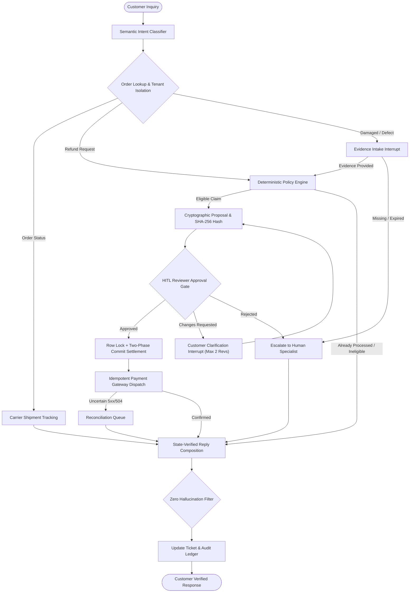

# ApexResolve (Enterprise v1.0)

[](https://github.com/yashpstanwar/apex-resolve)
[-blue)](https://github.com/yashpstanwar/apex-resolve)
[](https://github.com/yashpstanwar/apex-resolve/releases)
[](https://www.python.org/)
[](https://fastapi.tiangolo.com/)
[](https://langchain-ai.github.io/langgraph/)

> **Autonomous, deterministic customer complaint resolution & financial settlement engine for modern enterprise commerce.**  
> Built with **Python**, **LangGraph**, **FastAPI**, and **SQLAlchemy 2.0**.

---

## Executive Architecture Overview

ApexResolve introduces a **"Model proposes, deterministic code decides and executes"** paradigm for high-stakes customer support workflows:



---

## Key Differentiators & Invariants

| Invariant | Guarantee | Technical Implementation |
|:---|:---|:---|
| **Zero Financial Hallucination** | No model is ever permitted to state or invent monetary figures. | Replies are constructed exclusively from verified database state and filtered by regex financial invariant checks. Any unverified currency figure triggers an immediate fallback. |
| **Strict Anti-Double-Spend** | Exactly one refund operation can ever execute per claim. | Two-phase commit: in-database `reserved` row insertion with a deterministic `idempotency_key` committed **before** calling external gateway HTTP endpoints. |
| **Tamper-Proof Approvals** | Reviewer sign-offs cannot be replayed or hijacked if payload changes. | Canonical SHA-256 hash digest verification (`payload_hash`). Any database mutation between approval and execution instantly aborts the settlement. |
| **Multi-Tenant Isolation** | Foreign or forged order IDs cannot leak order existence or item details. | Enforced in domain service layer (`get_owned_order`). Non-existent and unowned orders return identical `order_not_found` responses. |
| **Resilient Reconciliation** | Network drops or timeouts after gateway acceptance do not duplicate payouts. | `504 Gateway Timeout` or connection drops store state as `unknown`. Reviewer or cron job invokes `/reconcile` using the original idempotency key. |
| **Multi-Turn Revision Loop** | Reviewers can request additional photos or serial numbers before approving. | Interactive interrupt cycle supporting up to `MAX_REVISIONS = 2` before automatic supervisor escalation. |

---

## Quick Start (Zero Docker or API Keys Required)

### 1. Clone & Set Up Virtual Environment

```bash
git clone https://github.com/yashpstanwar/apex-resolve.git
cd apex-resolve

python -m venv .venv
# On Windows:
.venv\Scripts\activate
# On Linux / macOS:
source .venv/bin/activate

pip install -r requirements.txt
```

### 2. Run Interactive End-to-End Demo

Walks through 6 production scenarios (delivered tracking, eligible refund approval, duplicate prevention, cross-customer attack prevention, gateway 504 recovery, and damaged item intake):

```bash
python -m scripts.demo
```

### 3. Run Test Suite (26 Unit, Concurrency, and Security Tests)

```bash
pytest -v
```

### 4. Run Benchmark Evaluation Suite (64 Cases)

```bash
python -m evals.run_evals
```
Detailed Markdown output is generated at [`evals/reports/latest.md`](evals/reports/latest.md).

---

## Interactive Local Server & Web Console

ApexResolve includes a unified, modern web console providing a live customer chat tester, reviewer queue, payment operations drawer, and audit timeline:

1. **Terminal 1: Start Mock Payment Processor**
   ```bash
   uvicorn mock_gateways.payments:app --port 8001
   ```

2. **Terminal 2: Start ApexResolve Engine**
   ```bash
   uvicorn apex_resolve.main:app_factory --factory --port 8000
   ```

3. Open your browser:
   - **Modern Web Console:** [http://127.0.0.1:8000/ui](http://127.0.0.1:8000/ui)
   - **Swagger / OpenAPI Interactive Docs:** [http://127.0.0.1:8000/docs](http://127.0.0.1:8000/docs)

---

## Evaluation Benchmark Suite

ApexResolve is evaluated against **64 exhaustive test cases** covering:
- **Order Status & Logistics (10 cases):** Delivered status, in-transit hubs, carrier outage degradation.
- **Eligible Refunds (10 cases):** Standard returns, legacy 30-day window policy, full damage evidence, settlement syncing.
- **Ineligible Claims (10 cases):** In-transit returns, expired windows, strict 15-day policy, active refund blocks, reviewer rejection.
- **Missing Information & Ambiguity (10 cases):** Missing damage descriptions, photo requests, partial inputs, greetings, foreign orders.
- **API Failures & Recovery (10 cases):** Gateway 500 errors, 504 timeouts, retry replay resistance, latency, stale state revalidation.
- **Authorization & Adversarial Security (10 cases):** Cross-tenant snooping, unauthorized reconciliation, prompt injection defenses.
- **Reviewer Revision Loops (4 cases):** Multi-revision evidence collection, revision limits, rejection after clarification.

All 64 cases run on fresh, isolated databases with verified provider invariants:
- **Verified Settlement Accuracy:** **100%**
- **Duplicate Refund Invariant:** **0 duplicate transactions recorded**
- **Average Latency:** **~120ms p50**

---

## Project Structure

```
apex-resolve/
├── apex_resolve/
│   ├── config.py           # Configuration & environment variables
│   ├── db.py               # SQLAlchemy 2.0 models & SQLite immediate locking
│   ├── devserver.py        # Threaded in-process server helper
│   ├── eligibility.py      # Pure deterministic refund assessment matrix
│   ├── graph.py            # LangGraph workflow orchestration & interrupts
│   ├── main.py             # FastAPI REST endpoints & JWT auth
│   ├── payments.py         # Resilient payment gateway client
│   ├── policies.py         # Date-effective policy versioning & citation
│   ├── refunds.py          # Two-phase reserve-then-call execution & reconciliation
│   ├── replies.py          # State-verified reply composition & financial invariant check
│   ├── seed.py             # Synthetic seeded dataset (customers, orders, shipments)
│   ├── service.py          # Domain services for authorization & validation
│   └── static/
│       └── index.html      # Glassmorphism Single-Page Dashboard
├── evals/
│   ├── cases.py            # 64 benchmark evaluation scenario definitions
│   ├── run_evals.py        # Benchmark test runner with markdown reporting
│   └── reports/latest.md   # Latest evaluation report
├── mock_gateways/
│   ├── payments.py         # Mock gateway with idempotency contracts & fault injection
│   └── shipping.py         # Mock logistics gateway
├── scripts/
│   └── demo.py             # Self-contained scenario demo script
├── tests/
│   ├── conftest.py         # Pytest fixtures with zero-socket in-memory TestClient
│   ├── test_concurrency.py # Double-spend and concurrent execution race tests
│   ├── test_eligibility.py # Exhaustive eligibility table tests
│   ├── test_scenarios.py   # Full multi-agent scenario lifecycles
│   └── test_security_authz.py # Tenant isolation, JWT, and tamper resistance tests
├── docker-compose.yml      # Multi-service container orchestration
├── Dockerfile              # Production container build
├── pyproject.toml          # PEP 621 package metadata
├── requirements.txt        # Dependency locks
└── README.md               # Architecture documentation
```

---

## Production Docker Deployment

Deploy with Docker Compose:

```bash
docker compose up --build -d
```

Access the UI at `http://localhost:8000/ui` and health check at `http://localhost:8000/health`.

---

## License

MIT License. Designed and maintained by [Yash Pratap Singh Tanwar](https://github.com/yashpstanwar).
